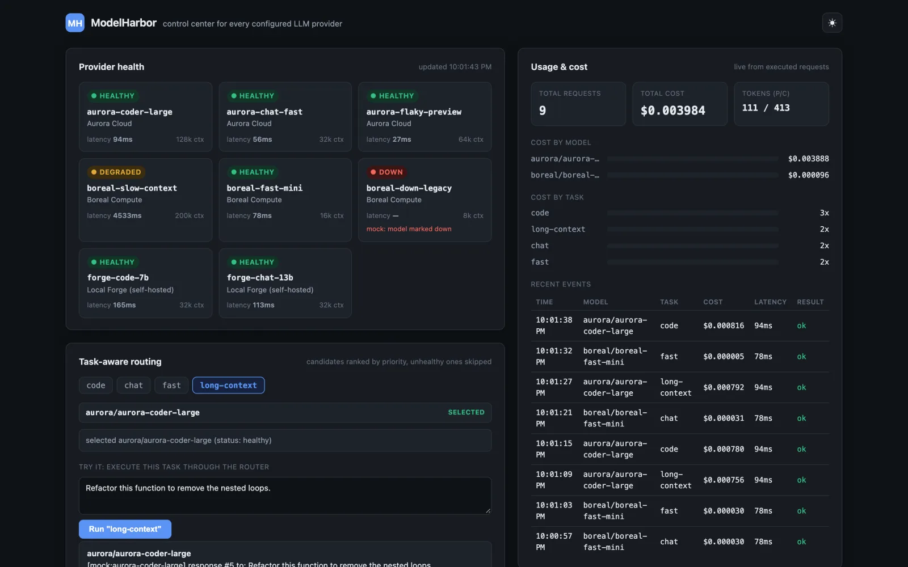
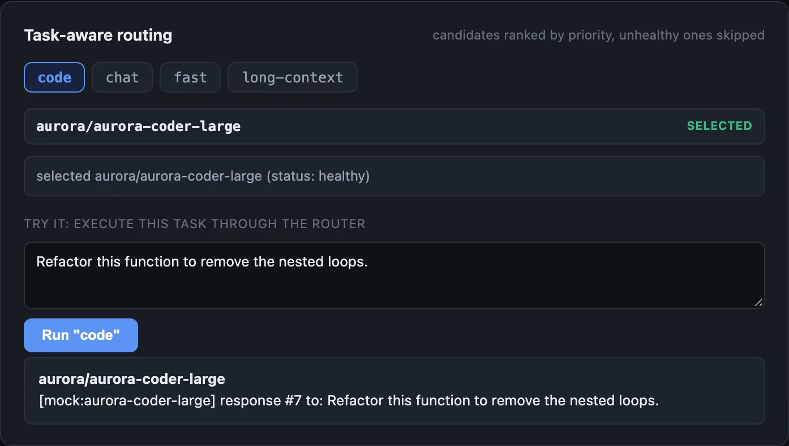
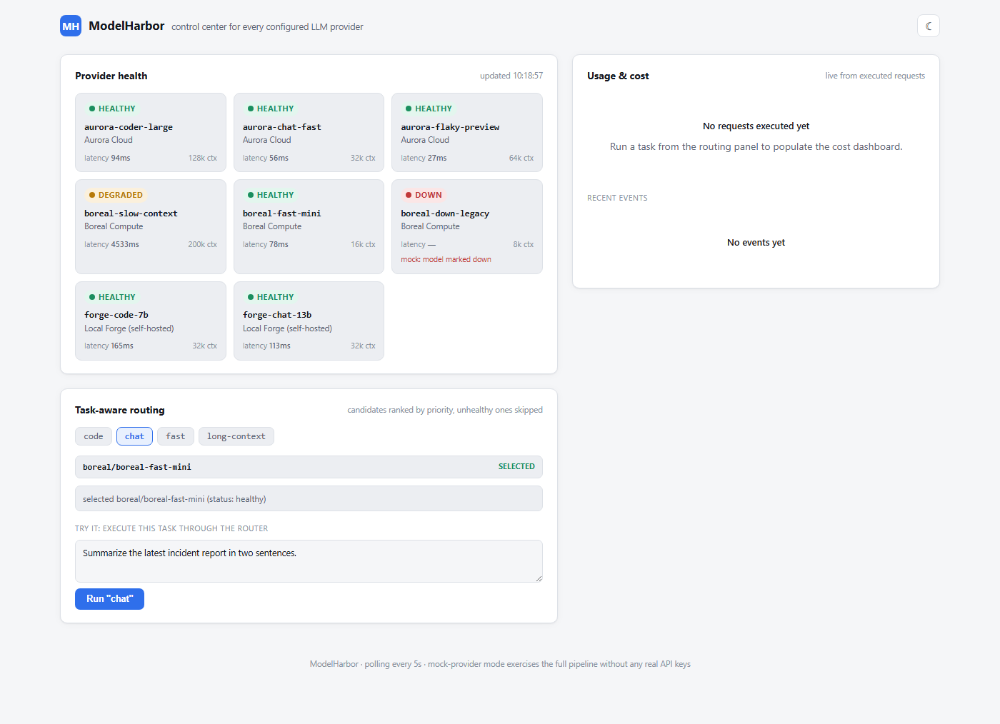
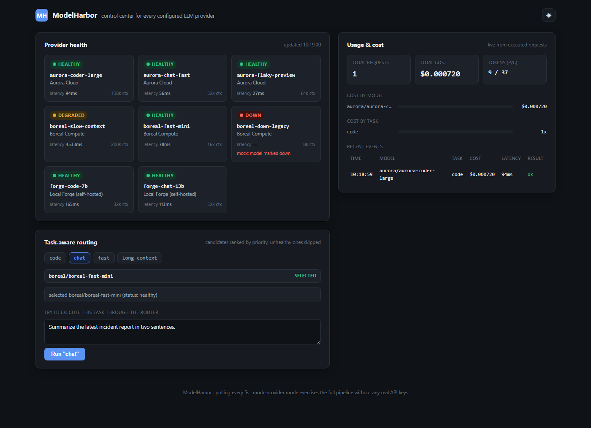

# ModelHarbor

A self-hosted Node server and React dashboard for a set of LLM providers. It
health-checks every configured model, routes each request to the best healthy
model for its task type (failing over to the next one if the call errors), and
records token usage and cost per request.

[Case study ↗](https://hellpuff.dev/work/modelharbor)



*Real screenshot (mock provider mode, no API keys): health for 8 mock models
across 3 providers (one degraded, one down), task-aware routing, and the usage
and cost panel after 9 routed requests.*

<details>
<summary>More screenshots</summary>



*Real screenshot: the routing panel choosing `aurora-coder-large` for a `code`
task and showing the mock response it executed.*





</details>

## Status

v1.0.0, self-hosted, single process. The mock provider path, routing,
failover and cost aggregation are covered by the test suite and run in CI on
Linux, macOS and Windows (Node 20). The live `openai-compatible` and `ollama`
adapters are tested against stubbed `fetch` only (see [Limitations](#limitations)).

## What it does

- **Health.** Each configured model is checked and the result cached for
  `healthCacheMs`. A model is `healthy`, `degraded` (the check succeeded but
  took longer than 4 s) or `down` (the check failed, with the error shown).
- **Routing.** Each task type (`code`, `chat`, `fast`, `long-context`) has a
  pool of candidate models ranked by `priority`. The router takes the first
  candidate that is not `down` (a `degraded` model is still used; one with no
  health data yet is skipped). When a request is executed and the chosen
  model's call throws, it moves on to the next candidate and records every
  attempt.
- **Cost.** Every executed request, successful or not, becomes a `UsageEvent`
  with token counts and a cost computed from the model's configured pricing.
  The dashboard aggregates them by model, provider, task and day.

## Prerequisites

- Node.js 20 or newer and npm (CI runs Node 20; also checked locally on Node 24).
- No API keys for the mock quickstart. Live mode needs a reachable
  OpenAI-compatible endpoint or Ollama server.

## Quickstart (mock mode, no API keys)

The default `modelharbor.config.json` uses the `mock` provider kind, which
simulates health checks and generations deterministically with no network
calls. It implements the same interface as the HTTP adapters, and CI runs
against it.

```bash
npm install
npm run build

npm run dev:server   # http://127.0.0.1:4180  (reads ./modelharbor.config.json)
npm run dev:web      # http://localhost:5180  (proxies /api to the server)
```

Open `http://localhost:5180`. The mock config has three providers and eight
models; `boreal-slow-context` is `degraded` and `boreal-down-legacy` is `down`.
In the routing panel, pick a task and press **Run**: the request is executed
through the router and appears in the usage and cost panel.

You can call the API directly too. The dev server proxies `/api` to
`127.0.0.1:4180` (output shortened with `…`):

```console
$ curl -s -X POST -H 'content-type: application/json' \
    -d '{"task":"chat","prompt":"hi"}' http://localhost:5180/api/route
{"task":"chat","attempted":[{"candidate":{"providerId":"boreal","modelId":"boreal-fast-mini"},"outcome":"selected"}],"chosen":{"providerId":"boreal","modelId":"boreal-fast-mini"},"reason":"selected boreal/boreal-fast-mini","text":"[mock:boreal-fast-mini] response #1 to: hi","events":[{…,"promptTokens":1,"completionTokens":69,"costUsd":0.000028,…,"success":true,"failoverCount":0}]}
```

To run the built output instead of the watchers (after `npm run build`):

```bash
npm start -w server                      # node server/dist/index.js on 127.0.0.1:4180
npm run preview -w web -- --port 5180    # serves web/dist; /api is proxied to :4180
```

## Going live

Live mode uses the same code path with HTTP adapters in place of `mock`.
Copy the example config and point the server at it:

```bash
cp modelharbor.config.example.json modelharbor.config.local.json   # *.local.json is gitignored
MODELHARBOR_CONFIG=./modelharbor.config.local.json npm run dev:server
```

Relative paths in `MODELHARBOR_CONFIG` / `MODELHARBOR_USAGE_LOG` resolve
against the directory you ran `npm` from.

Adapter kinds:

| `kind` | Talks to | Notes |
|---|---|---|
| `openai-compatible` | Any endpoint speaking the OpenAI chat-completions HTTP shape | OpenAI itself, LM Studio, vLLM, LiteLLM proxies, OpenRouter, or Anthropic behind an OpenAI-shim gateway |
| `ollama` | A real Ollama server's native REST API | Local, no API key |
| `mock` | Nothing; output is a deterministic function of `(modelId, call count)` | CI and demos |

Never commit a config with real `apiKey` values. `modelharbor.config.json`
is the tracked mock config; put live keys only in a `*.local.json` file
(gitignored) and point `MODELHARBOR_CONFIG` at it.

## Security model

- **Keys stay on the server.** `apiKey` is only read by the server-side
  adapters. `/api/config` drops it and strips credentials from `baseUrl`
  (userinfo, key-like query parameters); provider error text that reaches the
  dashboard (health errors, failover reasons) has the configured key, bearer
  tokens and `sk-…` strings replaced with `[redacted]`. The web bundle never
  receives a key.
- **No authentication.** Anyone who can reach the API can run prompts on your
  providers and spend your money. The server therefore binds `127.0.0.1` by
  default (`HOST` changes it; only do that behind your own auth proxy), sends no
  CORS headers unless `MODELHARBOR_CORS_ORIGIN` names one exact origin (a
  wildcard is ignored), requires `content-type: application/json` on
  `POST /api/route` so a cross-site form cannot trigger it, and rejects request
  bodies over 1 MiB.

| Env var | Default | Purpose |
|---|---|---|
| `MODELHARBOR_CONFIG` | `modelharbor.config.json` | Config file path |
| `MODELHARBOR_USAGE_LOG` | unset (in-memory) | JSONL file to persist usage events |
| `HOST` | `127.0.0.1` | Bind address |
| `PORT` | `4180` | Port |
| `MODELHARBOR_CORS_ORIGIN` | unset (no CORS) | One exact origin allowed to call the API cross-origin, e.g. a dashboard built with `VITE_API_BASE_URL` |

See [SECURITY.md](SECURITY.md) for how to report a vulnerability.

## Architecture

```
                         ┌─────────────────────────┐
                         │   web/ (Vite + React)   │
                         │  Health · Routing · Cost │
                         │  panels, polling every 5s│
                         └────────────┬────────────┘
                                      │ fetch /api/*
                                      ▼
┌─────────────────────────────────────────────────────────────────┐
│ server/ (Node, zero-framework http.Server)                       │
│                                                                   │
│  config.ts ──▶ ProviderConfig[] ──▶ providers/factory.ts         │
│                                        │                         │
│                     ┌──────────────────┼───────────────────┐     │
│                     ▼                  ▼                   ▼     │
│              OllamaClient   OpenAiCompatibleClient   MockProvider │
│                     └──────────────────┴───────────────────┘     │
│                                 ProviderClient                    │
│                                      │                            │
│              ┌───────────────────────┼────────────────────┐      │
│              ▼                       ▼                    ▼      │
│        health.ts               router.ts              execute.ts │
│      (TTL-cached                (pick highest-       (route + run,│
│       checkHealth per            priority healthy      live fail- │
│       model)                     candidate)             over,     │
│              │                       │                  UsageEvent│
│              └──────────┬────────────┘                  per try)  │
│                         ▼                                    │    │
│                    api.ts (HTTP routes)         costStore.ts ◀────┘
│                                                  (aggregate, persist)
└─────────────────────────────────────────────────────────────────┘
```

The router and the execution path are separate. `GET /api/route` answers
"what would be chosen right now" from the health cache only, with no side
effects, so the dashboard can poll it every 5 seconds. `POST /api/route` runs
the prompt, fails over if a call throws, and is the only place that writes
`UsageEvent`s.

### API

| Endpoint | Method | Description |
|---|---|---|
| `/api/config` | GET | Redacted provider/model config (no API keys ever leave the server) |
| `/api/health` | GET | Latest health snapshot; `?force=true` bypasses the TTL cache |
| `/api/route` | GET | Routing decision for `?task=` without executing anything |
| `/api/route` | POST | `{ task, prompt }` → executes with live failover, records usage |
| `/api/usage` | GET | Cost/usage summary, aggregated by model / provider / task / day |
| `/api/usage/events` | GET | Most recent raw usage events, `?limit=` |

## Testing

```bash
npm run test           # 144 tests (vitest)
npm run test:coverage   # same, coverage-gated: 90% stmts/lines/funcs, 85% branches
npm run lint            # eslint, zero warnings
npm run typecheck       # tsc --noEmit, both workspaces
```

The live HTTP adapters (`ollama.ts`, `openaiCompatible.ts`) are unit-tested by
stubbing `fetch` (mocked HTTP, labelled as such in the test files) rather than
hitting a real network, so the success and error branches run in CI without
Ollama or an API key. `server/test/setup.ts` installs a
network guard for the whole suite: any `fetch` to a non-loopback host fails
the test. The real adapters have **not** been exercised against live OpenAI /
Ollama endpoints as part of this repository's tests.

## Project layout

```
server/           Node/TypeScript API: config, health, routing, execution, cost
  src/providers/   ollama, openai-compatible, and mock adapters
  test/            144 vitest cases
web/              Vite + React + TypeScript dashboard, hand-rolled CSS design tokens
modelharbor.config.json          default (mock) config, used by CI and `npm run dev:*`
modelharbor.config.example.json  documented live-mode config to copy and edit
```

## Limitations

- **Live adapters are not tested against real providers.** Only stubbed-`fetch`
  tests cover `openai-compatible` and `ollama`; running them against real
  endpoints needs your own keys or Ollama server.
- **No authentication.** See the security model above; the server listens on
  loopback only by default.
- **Usage is in memory unless `MODELHARBOR_USAGE_LOG` is set**; restarting the
  server without it discards the cost history.
- **Narrow screens:** the dashboard fits a phone-width viewport (checked at
  320 px and 390 px with no horizontal page scroll); the recent-events table
  scrolls sideways inside its own panel.

## Contributing

See [CONTRIBUTING.md](CONTRIBUTING.md). Changes are listed in
[CHANGELOG.md](CHANGELOG.md).

## License

MIT © 2026 Prabesh Sharma. See [LICENSE](LICENSE).
